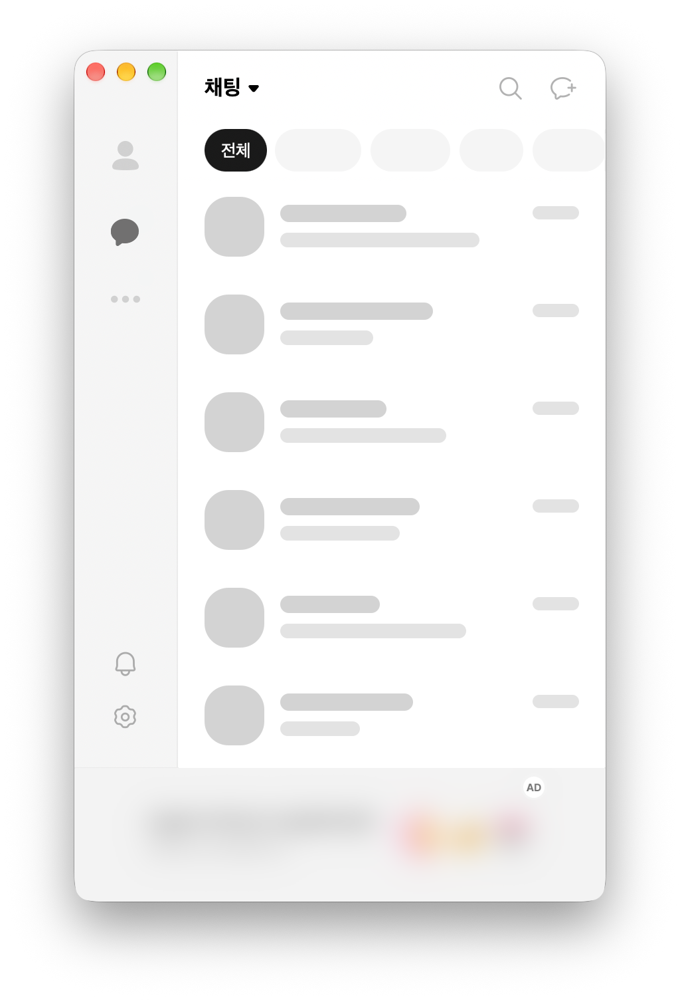
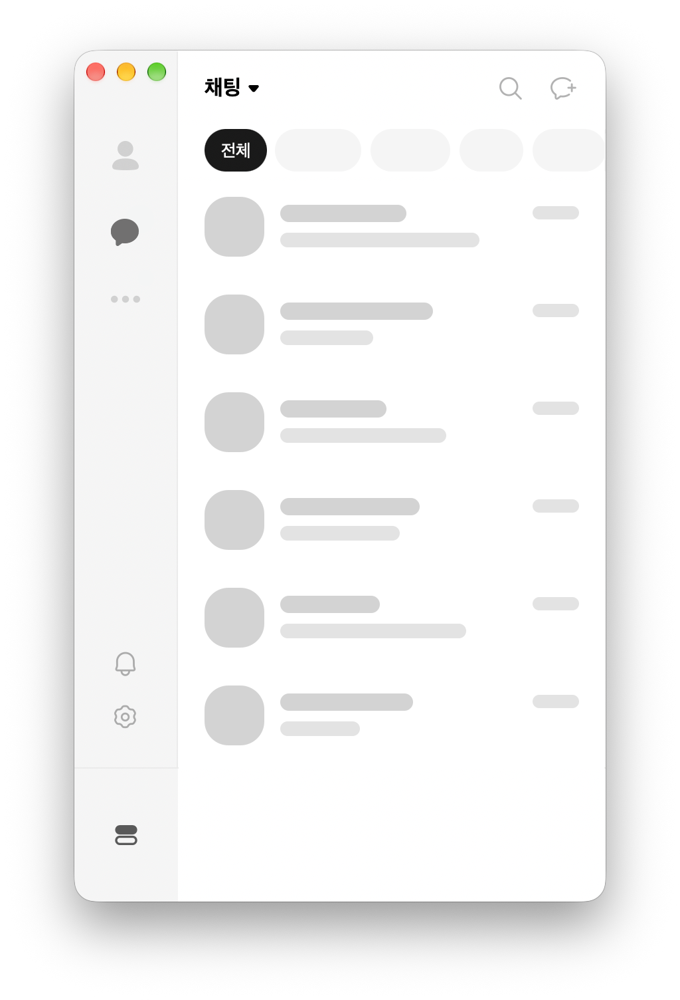
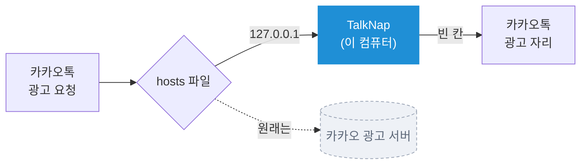

<picture>
  <source media="(prefers-color-scheme: dark)" srcset="assets/readme/banner-dark.svg">
  
</picture>

**TalkNap** — 카카오톡 광고 칸에 낮잠을.
TalkNap은 카카오톡 PC(Windows, macOS)의 광고 배너를 비우는 작은 프로그램입니다. 예전 이름은 KakaoAdHide입니다.
카카오톡이 광고를 받아 오는 요청을 이 컴퓨터 안에서 대신 받아, 광고 대신 **카카오톡 배경색만 칠한 빈 칸**을 돌려줍니다.

[](../../releases/latest)
[](../../actions/workflows/build.yml)


[](LICENSE)

**[다운로드](https://pandemoniummm.github.io/TalkNap/)** · **[릴리스](../../releases/latest)** · **[동작 방식](#어떻게-동작하나요)** · **[무엇이 다른가요](#무엇이-다른가요)** · **[자주 묻는 질문](#자주-묻는-질문)** · **[앞으로](#앞으로)**

Windows (64비트) · macOS 11 이상 (Apple silicon, Intel)

> [!NOTE]
> 비공식 프로젝트입니다. 카카오(Kakao Corp.)와 관련이 없습니다.

<p align="center">
  <picture>
    <source media="(prefers-color-scheme: dark)" srcset="site/kakaotalk-mac-ad-dark.png">
    
  </picture>
  <picture>
    <source media="(prefers-color-scheme: dark)" srcset="site/kakaotalk-mac-dark.png">
    
  </picture>
  <br>
  <sub>왼쪽: 원래 카카오톡 · 오른쪽: TalkNap을 켠 카카오톡 (macOS)</sub>
</p>

## 기능

| | |
|---|---|
| **카카오톡이 직접 그리는 빈 칸** | 창을 끌거나 크기를 바꾸거나 다른 모니터로 옮겨도 어긋나지 않습니다. |
| **카카오톡을 건드리지 않음** | 실행 파일 수정이나 코드 주입이 없습니다. |
| **광고 서버에 접속하지 않음** | 광고 노출·클릭 기록도 보내지 않습니다. |
| **팝업 광고도 막음** | Windows에서 트레이 근처에 따로 뜨는 광고 팝업도 뜨지 않게 합니다. |
| **빈 칸의 메뉴 버튼** | 사이드바 아래 버튼으로 메뉴를 엽니다. 카카오톡 아이콘처럼 창이 비활성이면 흐려집니다. |
| **풀리면 알려 줌** | 다른 프로그램이 설정을 지우면 알림을 띄우고, [다시 설정]으로 바로 고칩니다. |
| **가벼움** | 카카오톡이 켤 때와 하루 한 번 보내는 요청에만 답합니다. |
| **안전한 업데이트** | 새 버전이 나오면 알려 주고, 서명을 확인한 뒤에만 설치합니다. |

## 설치

운영체제를 눌러 펼치세요.

<details>
<summary><b>Windows</b></summary>

1. [다운로드 페이지](https://pandemoniummm.github.io/TalkNap/)나 [Releases](../../releases/latest)에서 `TalkNap.exe`를 받아 실행합니다.
2. 설정 안내가 뜨면 **설정하기** → 인증서 설치 확인 창에서 **예** → 사용자 계정 컨트롤 창에서 **예**.
3. 설치가 끝나면 TalkNap이 카카오톡을 켭니다(이미 켜져 있으면 그대로).

예전 KakaoAdHide(낮잠)를 쓰고 있었다면, 업데이트나 설치 때 TalkNap이 옛 프로그램 파일, 바로가기, 설정, 인증서, hosts 줄을 새 이름으로 옮기고 옛것을 지웁니다.

> **처음 실행할 때**: **"Windows의 PC 보호"** 창이 뜨면 **추가 정보 → 실행**을 누르세요. 코드 서명을 하지 않은 프로그램이라 뜨는 경고입니다.

카카오톡 자체 자동 실행 설정은 건드리지 않습니다. 로그인할 때 카카오톡이 TalkNap보다 먼저 켜지면, 몇 분 동안 내장 배너가 보였다가 빈 칸으로 바뀝니다.

**사용**: 카카오톡 빈 칸 왼쪽, 사이드바 아래의 **TalkNap 버튼**을 누르면 메뉴가 열립니다(트레이 아이콘 메뉴와 같습니다).
메뉴: 카카오톡 다시 시작, 업데이트 확인, 업데이트 자동 확인, TalkNap 제거, 종료

<details>
<summary>설치하면 바뀌는 것</summary>

| 항목 | 내용 |
|---|---|
| `%LOCALAPPDATA%\TalkNap\` | 프로그램 파일과 인증서 |
| 시작 프로그램 폴더의 `TalkNap.lnk` | 로그인할 때 실행 |
| 현재 사용자의 신뢰할 수 있는 루트 인증서 | `TalkNap local ad server` (광고 주소 두 개 전용) |
| `C:\Windows\System32\drivers\etc\hosts` | `# TalkNap begin` ~ `# TalkNap end` 사이의 두 줄 |
| `HKCU\Software\TalkNap` | 설정 |
| 설정 > 앱 > 설치된 앱 | `TalkNap (카카오톡 광고 칸 비우기)` 항목 |

</details>

<details>
<summary>제거, 명령줄</summary>

다음 중 하나로 지웁니다. hosts 줄, 인증서, 설정을 모두 지우고 원래대로 되돌립니다.
- **설정 > 앱 > 설치된 앱 > TalkNap > 제거**
- TalkNap 메뉴의 **TalkNap 제거…**
- PowerShell:
  ```powershell
  & "$env:LOCALAPPDATA\TalkNap\TalkNap.exe" --uninstall
  ```

| 명령 | 동작 |
|---|---|
| `TalkNap.exe` (받은 파일) | 설치 후 실행 |
| `TalkNap.exe --uninstall` | 제거 |
| `TalkNap.exe --update` | 지금 업데이트 확인(새 버전이 있으면 검증 후 설치) |
| `--quiet` | 설치, 제거할 때 안내 창을 띄우지 않음 |

</details>

</details>

<details>
<summary><b>macOS</b></summary>

1. [다운로드 페이지](https://pandemoniummm.github.io/TalkNap/)나 [Releases](../../releases/latest)에서 `TalkNap.dmg`를 받아 열고, `TalkNap`을 `Applications`로 끌어다 놓습니다.
2. 응용 프로그램 폴더에서 TalkNap을 실행합니다.
3. 설정 안내에서 **설정하기** → 인증서 신뢰 변경에 **Mac 로그인 암호** → hosts 변경에 **관리자 암호**.

> **처음 실행할 때**: **"Apple은 'TalkNap'에 악성 코드가 없음을 확인할 수 없습니다"** 창이 뜨면 **완료**를 누르고, **시스템 설정 > 개인정보 보호 및 보안** 아래쪽의 **그래도 열기**를 누른 뒤 다시 실행합니다. Apple 유료 개발자 서명(공증)을 하지 않은 앱이라 처음 한 번 뜨는 경고입니다.

카카오톡이 TalkNap보다 먼저 켜지면, 카카오톡이 광고를 다시 요청할 때까지 내장 배너가 보일 수 있습니다. 메뉴의 **카카오톡 다시 시작**을 누르면 바로 비워집니다.

**사용**: 카카오톡 빈 칸 왼쪽 버튼이나 메뉴 막대 아이콘으로 메뉴를 엽니다.
메뉴: 카카오톡 다시 시작, 업데이트 확인, 업데이트 자동 확인, 로그인할 때 실행, TalkNap 제거, 종료

예전 KakaoAdHide(낮잠)를 쓰고 있었다면, 업데이트 때 TalkNap이 옛 앱, 로그인 항목, 설정, 인증서, hosts 줄을 새 이름으로 옮기고 옛것을 지웁니다.

<details>
<summary>설치하면 바뀌는 것, 제거</summary>

| 항목 | 내용 |
|---|---|
| `/Applications/TalkNap.app` | 프로그램 (쓸 수 없으면 `~/Applications`) |
| `~/Library/LaunchAgents/io.github.pandemoniummm.TalkNap.plist` | 로그인할 때 실행 (메뉴에서 끌 수 있음) |
| 로그인 키체인 | `TalkNap local ad server` 인증서 (SSL에만 신뢰, 광고 주소 두 개 전용) |
| `/etc/hosts` | `# TalkNap begin` ~ `# TalkNap end` 사이의 두 줄 |
| `~/Library/Application Support/TalkNap/` | 설정과 인증서 |

제거: 메뉴 > **TalkNap 제거…** (hosts 줄, 인증서, 로그인 항목, 설정을 지우고 앱을 휴지통으로 옮깁니다)

</details>

</details>

## 어떻게 동작하나요?

카카오톡은 광고를 띄우기 전에 광고 서버(`serv.ds.kakao.com`)에 "띄울 광고를 달라"고 묻습니다. TalkNap은 이 질문이 카카오 서버 대신 **이 컴퓨터로 오게 하고**, 광고 대신 빈 칸을 돌려줍니다. 카카오톡은 받은 빈 칸을 원래 광고 자리에 직접 그립니다.



## 무엇이 다른가요?

광고 칸을 없애는 방법은 여러 가지입니다. TalkNap은 카카오톡이 받는 **광고 내용**을 바꾸고, 창에는 손대지 않습니다.

| 방식 | 창을 옮기거나 크기를 바꿀 때 | 카카오톡이 업데이트되면 | 광고 요청 |
|---|---|---|---|
| **빈 광고를 대신 돌려주기** (TalkNap) | 카카오톡이 직접 그려서 어긋나지 않음 | 광고 주소나 응답 형식이 바뀔 때만 손봄 | 이 컴퓨터 안에서 끝남 |
| 카카오톡 창 안쪽을 늘려 광고 칸 덮기 | 바뀔 때마다 다시 맞춰야 함 | 창 구조가 바뀌면 깨짐 | 그대로 나감 |
| 광고 칸 위에 다른 창 덮기 | 창을 따라다니느라 늦거나 어긋날 수 있음 | 대체로 그대로 | 그대로 나감 |
| 카카오톡 실행 파일 고치기 | 깔끔함 | 업데이트마다 다시 고쳐야 함 | 방식에 따라 다름 |

## 믿어도 되나요?

처음 실행할 때 동의를 받은 뒤, 아래 세 가지를 한 번만 설정합니다.

- **인증서**: 이 컴퓨터에서 새로 만든 인증서를 신뢰하도록 등록합니다.
  - 카카오톡 광고 주소 두 개(`serv.ds.kakao.com`, `display.ad.daum.net`)에만 쓸 수 있고, 다른 인증서를 발급할 수 없는 종류(CA 아님)입니다.
  - 개인키는 이 컴퓨터를 떠나지 않습니다(현재 사용자만 읽을 수 있는 파일).
- **hosts 파일**: 두 광고 주소를 이 컴퓨터(127.0.0.1)로 보내는 줄을 넣습니다. 관리자 권한이 필요합니다.
- **로컬 서버**: TalkNap이 443 포트에서 **이 컴퓨터에서 온 연결만** 받아, 광고 요청에는 빈 광고를, 그 밖의 요청에는 빈 응답을 돌려줍니다.

> [!IMPORTANT]
> 인증서는 광고 주소 두 개에만 쓸 수 있습니다. 개인키가 새더라도 은행·메일 같은 다른 사이트를 위조할 수는 없고, 카카오톡 광고 칸에 다른 내용을 띄우는 정도만 가능합니다.

그 밖에:

- **밖으로 보내는 것이 없음**: 이 컴퓨터 밖으로 보내는 요청은 업데이트 확인뿐입니다([업데이트](#업데이트)).
- **빈 광고에는 짧은 스크립트만**: 광고 칸을 칠하고, 메뉴 버튼을 그리고, **이 컴퓨터의 TalkNap**하고만 신호를 주고받습니다. 외부 요청이 없는지는 테스트로 확인합니다. 신호에는 설치할 때 만든 무작위 값이 붙어서, 다른 웹 페이지가 흉내 낼 수 없습니다.
- **공개 소스**: 릴리스 파일은 GitHub Actions가 이 저장소의 소스로 만듭니다. 받은 파일이 Releases의 파일과 같은지는 함께 올린 `SHA256SUMS.txt`로 확인할 수 있습니다.
  ```powershell
  Get-FileHash .\TalkNap.exe -Algorithm SHA256
  ```

## 자주 묻는 질문

**다음(Daum) 같은 웹사이트 광고도 사라지나요?**
카카오 애드핏 광고(다음 등에서 쓰는 카카오 광고)는 같은 주소를 써서 함께 안 보입니다. 구글 광고처럼 다른 회사 광고는 그대로입니다. Chrome은 이때 "로컬 네트워크 액세스" 권한을 물을 수 있는데, 허용하지 않아도 됩니다.

**TalkNap을 끄면 어떻게 되나요?**
카카오톡 내장 배너가 뜰 뿐, 다른 인터넷 통신에는 영향이 없습니다.

**백신이 hosts 파일을 되돌렸어요.**
10분 안에 "광고 차단이 풀렸습니다" 알림이 뜹니다. 알림이나 [**다시 설정**]을 누르면 관리자 권한을 묻고 다시 적용합니다.

**광고가 다시 보여요.**
먼저 메뉴의 **카카오톡 다시 시작**을 눌러 보세요. 그래도 보이면 카카오톡이 광고 주소나 응답 형식을 바꾼 것일 수 있습니다. 카카오톡 버전과 함께 [이슈](../../issues)로 알려 주세요.

**왜 보안 경고가 뜨나요?**
유료 코드 서명을 하지 않은 프로그램이라 Windows는 SmartScreen, macOS는 Gatekeeper 경고가 처음 한 번 뜹니다.

## 업데이트

- 실행 1분 뒤, 그 뒤로 하루 한 번 GitHub의 최신 릴리스를 확인합니다. 요청에는 `User-Agent: TalkNap/<버전>` 말고 아무 정보도 담지 않습니다. GitHub에는 접속 IP가 남습니다.
- 새 버전이 있으면 알려 줍니다. **업데이트를 고르기 전에는 아무것도 받지 않습니다.**
- 받은 파일은 아래를 모두 확인한 뒤에만 설치합니다. 하나라도 맞지 않으면 설치하지 않고 릴리스 페이지를 안내합니다.
  - 다운로드 주소가 이 저장소의 Releases인지
  - 파일 크기와 SHA-256이 업데이트 정보와 같은지
  - 업데이트 정보의 서명이 프로그램에 들어 있는 공개키와 맞는지
  - (macOS) dmg 안 앱의 번들 ID·버전과 코드 서명
- 자동 확인 끄기: 메뉴의 **업데이트 자동 확인**

## 앞으로

계획 중인 것입니다. 바뀔 수 있습니다.

- **내 배너**: 빈 칸 대신 내가 고른 사진(반려동물, 가족 등)이나 색을 띄웁니다. 사진은 이 컴퓨터 안에서만 쓰고, 어디로도 보내지 않습니다.
- **배너 펫**: 광고 칸에 사는 작은 동물을 키웁니다. 카카오톡을 쓰는 만큼 자라거나 반응합니다.
- **macOS 다른 광고 자리 확인** ([#3](../../issues/3))

원하는 기능은 [이슈](../../issues)로 알려 주세요.

## 확인한 환경

- Windows 11, 카카오톡 PC 26.10.0
- macOS 27.2 (Apple silicon), 카카오톡 Mac 26.10.0

## 개발

빌드와 릴리스는 [docs/development.md](docs/development.md), 카카오톡이 광고를 받는 방식은 [docs/kakaotalk.md](docs/kakaotalk.md)를 보세요.

## 면책

이 프로그램은 있는 그대로 제공되며, 사용에 따른 책임은 사용자에게 있습니다. 자세한 내용은 [LICENSE](LICENSE)를 보세요.
